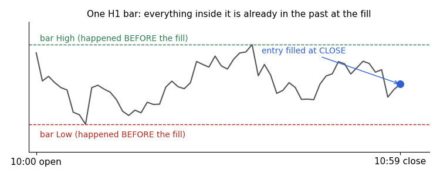
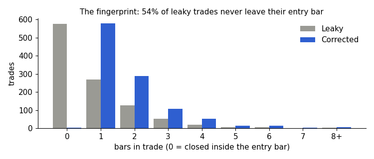
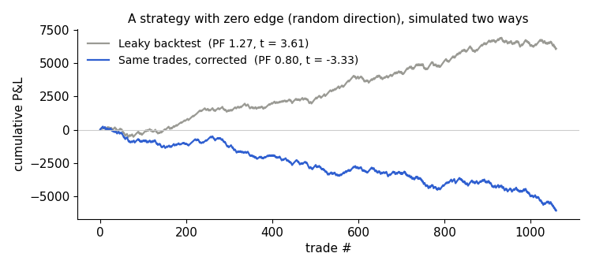
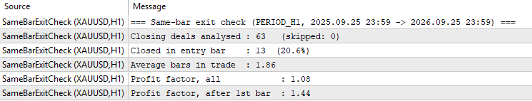
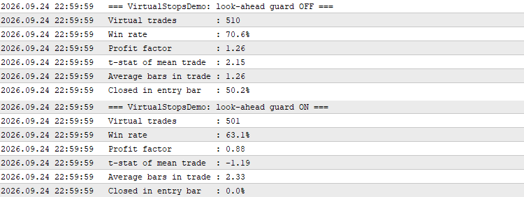
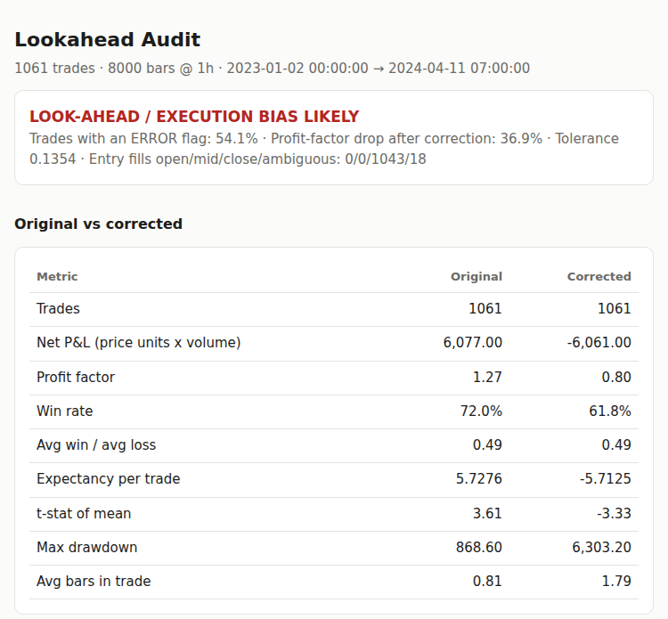

# How a Look-Ahead Bug Turned a Profit Factor of 1.2 into 3.9 — and How to Catch It Automatically

> Code: the MQL5 files are in [`mql5/`](../mql5/); the Python auditor is the rest of this repository.

## Introduction

Every algorithmic trader eventually meets the backtest that is too good to be true. Mine came from a reinforcement-learning agent trading XAUUSD on H1. Checkpoint after checkpoint, the evaluation reported a **profit factor between 2.7 and 3.9**, and an account balance that climbed past **$200,000**.

The real numbers, after one line of logic was fixed, were a **profit factor of about 1.1–1.2** and a balance of **$17,000–21,000**. Nothing about the model changed. The strategy never had the edge the backtest showed. The simulator had been handing it information from the past that no live order could ever use.

This article covers:

1. the exact mechanism of the bug, with before-and-after code;
2. the statistical fingerprint that exposed it;
3. why a strategy with **zero** edge can pass a t > 3 significance test with this bug in place;
4. three other forms of look-ahead that appeared later in the same project;
5. an Expert Advisor that reproduces the bug inside the Strategy Tester, and what the tester's modelling modes can and cannot catch;
6. two tools to detect it: an MQL5 include you can drop into any Expert Advisor or script, and an open-source Python auditor for trade logs.

## 1. The setup

The agent observes the market once per closed H1 bar and chooses one of four actions: WAIT, BUY, SELL or CLOSE. An environment simulates the trade from there:

- entries and voluntary closes are filled at the **close** of the decision bar;
- stop-loss, take-profit, break-even and trailing stops are enforced **intrabar**, using each bar's High and Low, so that a stop hit mid-bar is not missed just because the close came back.

Both rules are reasonable, and the second one is actually a fix for an earlier, opposite bug. When exits were priced off the close alone, a losing trade could sit beyond its stop for a whole bar, and the logs showed individual losses several times larger than the intended 1% risk.

The problem was how the two rules combined.

## 2. The bug

Here is a simplified version of the step logic before the fix:

```python
def step(self, action, bar):
    price = bar.close

    if action == BUY and self.position == 0:
        self.open_long(entry=price)                     # filled at the CLOSE

    if self.position != 0:
        # intrabar exits, evaluated on the same bar...
        if self.position == 1 and bar.low <= self.sl:
            self.close(self.sl, reason="SL")
        elif self.position == 1 and bar.high >= self.tp:
            self.close(self.tp, reason="TP")
        # ...break-even and trailing use bar.high / bar.low too
```

Look at the timeline of a single H1 bar:

```
10:00 open ──── high ─── low ──── 10:59 close
                                       ▲
                                       └─ the agent decides and is filled HERE
```



*Fig. 1. Everything inside the entry bar is already in the past when a close-price fill happens*

The entry is filled at the close, the last price of the bar. Everything else in that bar (its High, its Low, every tick) happened **before** the fill. Checking the new position's stop-loss and take-profit against that bar's High and Low asks whether the trade would have been stopped or would have taken profit using prices from the past.

The result is systematically optimistic, for two reasons:

- If the bar's range reaches the take-profit on the favourable side, the trade books a win for a move that ended before the position existed.
- Break-even and trailing stops "arm" on the bar's extreme and lock in profit that the position never held.

The fix is a guard that skips every intrabar check on the bar where the position was opened:

```python
def step(self, action, bar):
    price = bar.close
    just_opened = False

    if action == BUY and self.position == 0:
        self.open_long(entry=price)
        just_opened = True

    # LOOK-AHEAD GUARD: this bar's High/Low happened before our fill.
    # Intrabar SL/TP/BE/trailing checks start on the NEXT bar.
    if self.position != 0 and not just_opened:
        ...  # same exit checks as before
```

That is the whole fix. Every checkpoint trained before it (from 250,000 up to 5,000,000 steps) had to be thrown away. The agent had learned to exploit the simulator, not the market.

## 3. The fingerprint: trades that live and die inside one bar

The bug was caught because the numbers were too good, and an independent audit of two checkpoints was run instead of trusting them. One statistic gave it away immediately:

> **About 78% of trades had `bars_in_trade == 0`:** they opened and closed on the identical bar.

For a strategy that decides once per H1 bar and has no tick-level execution, that figure should be close to zero. A trade filled at the close cannot legitimately exit before the next bar begins.

This makes **average bars in trade** the cheapest look-ahead test there is. After the incident, the evaluation callback prints this warning on every run:

```python
if 0 < avg_bars < 1.0:
    print("WARNING: average_bars_in_trade < 1.0")
    print("Most trades are closing on the SAME bar they were opened on.")
    print("This is the exact signature of a look-ahead bug.")
```



*Fig. 2. The fingerprint: in the leaky backtest most trades never leave their entry bar*

The check costs one line and would have saved weeks of training on a broken environment.

## 4. Why statistics won't save you

A natural defence is "I only accept strategies with a strong t-statistic." It does not help here, because the bias is not noise. It adds a small, consistent positive amount to a large share of trades, and consistent positive amounts are exactly what a t-test rewards.

To show this, I built a synthetic gold-like H1 market and a strategy that **picks its direction at random**, so its true edge is exactly zero. I simulated it twice on the same data:

- **Leaky:** filled at the signal bar's close, with SL/TP checked on that same bar and TP taking priority when both are touched.
- **Clean:** filled at the close, with SL/TP checked from the next bar and SL taking priority when both are inside one bar.

| Metric | Leaky backtest | Same trades, corrected |
|---|---:|---:|
| Profit factor | **1.27** | **0.80** |
| Win rate | 72.0% | 61.8% |
| Net P&L | +6,077 | −6,061 |
| t-statistic of mean trade | **3.61** | −3.33 |
| Average bars in trade | **0.81** | 1.79 |



*Fig. 3. A strategy with zero edge: the leaky backtest rises, the corrected re-simulation falls*

A coin-flip strategy passes a t > 3 threshold. The only honest signal in that table is the one in the last row.

## 5. Look-ahead has more than one face

Fixing the entry-bar check did not end the problem. The same project later found three more variants. Each is worth checking in your own pipeline.

**5.1 Look-ahead inside an analysis tool.** An offline "what if we had used a partial close?" tool searched forward up to 200 bars for any favourable move that would have triggered the partial exit. The trades it analysed lasted a median of **one** bar. When no trigger was found, it quietly fell back to the trade's real outcome. That mix of two worlds could only ever improve on the baseline, never hurt it. The tool also used the wrong trigger constant (1.0 × ATR instead of the production 0.5 × ATR). It was replaced by a replay that reproduces the production exit logic exactly and was parity-checked against 612 of 612 real trade outcomes. **Lesson:** your research tools need the same audit as your simulator.

**5.2 Daily data aligned to the wrong day.** Daily macro series (yields, dollar index, volatility indices) are published with a date. If that date is joined to intraday bars that occur *before* the value was known, every feature built on it is peeking. In this project, a one-day misalignment of the daily macro inputs was found and documented, and the buggy files were kept as evidence. **Lesson:** for every external series, write down when each value became available, not only which day it describes.

**5.3 Timezones.** Broker server time, the data vendor's time and UTC rarely agree. For one tick-data source in this project, the offset to broker server time had to be derived empirically, and it was 7 hours. A misaligned join can put a bar's future inside its own features, or match a fill to the wrong bar entirely.

**5.4 Ambiguous bars.** When a bar's range contains both the stop-loss and the take-profit, OHLC data cannot tell you which came first. Choosing the take-profit is a quiet, optimistic look-ahead. A defensible bar-level simulator assumes the stop-loss first, or goes down to tick data.

## 6. Detecting it in MQL5

### 6.1 In MQL5: `SameBarExitCheck.mqh`

The include [`SameBarExitCheck.mqh`](../mql5/SameBarExitCheck.mqh) pairs entry and exit deals by position ID, maps each to its bar with `iBarShift`, and reports:

- the share of positions closed inside their entry bar;
- the average number of bars in a trade;
- the profit factor on all trades and on trades that survived past the entry bar.

The core pairing loop:

```cpp
long  entry  = HistoryDealGetInteger(ticket, DEAL_ENTRY);
ulong pos_id = (ulong)HistoryDealGetInteger(ticket, DEAL_POSITION_ID);

if(entry == DEAL_ENTRY_IN) { /* remember time and commission for pos_id */ }
else if(entry == DEAL_ENTRY_OUT || entry == DEAL_ENTRY_OUT_BY)
  {
   int bar_in  = iBarShift(sym, tf, g_entries[e].time, false);
   int bar_out = iBarShift(sym, tf, t, false);
   int bars    = bar_in - bar_out;          // 0 = closed inside the entry bar
   ...
  }
```

It works in two places:

- **On your account history.** Run the [`SameBarExitCheck.mq5`](../mql5/SameBarExitCheck.mq5) script on a demo or live account. This gives a baseline of how your real executions behave.
- **Inside the Strategy Tester.** Include the file in an Expert Advisor and call it when the test ends:

```cpp
#include "SameBarExitCheck.mqh"

double OnTester()
  {
   SameBarExitReport(PERIOD_H1, 0, TimeCurrent());
   return 0.0;
  }
```

This matters most for EAs that simulate their own stops or virtual trades on "new bar" events, where exactly this bug can appear. If the tester shows most positions closing inside their entry bar and your demo account does not, the simulation and reality disagree, and the simulation is the one to distrust.



*Fig. 4. The same check on a live demo account: 20.6% of positions closed inside their entry bar (real tick executions), versus 78% in the broken backtest*

### 6.2 How the include works

MetaTrader 5 records **deals**, not positions. A position is one entry deal plus one or more exit deals, and all of them carry the same `DEAL_POSITION_ID`. The include rebuilds each position from that identifier in a single pass over the history.

**Step 1: select the history and keep only trading deals.** `HistorySelect(from, to)` loads the deals of the window. Balance operations, credits and similar records also appear as deals, so everything whose `DEAL_TYPE` is not `DEAL_TYPE_BUY` or `DEAL_TYPE_SELL` is skipped. Optional symbol and magic-number filters let you isolate one Expert Advisor on a shared account.

**Step 2: remember every entry.** For a `DEAL_ENTRY_IN` deal the include stores the position identifier, the time and the entry commission. Exits normally follow their entries closely, so the lookup scans the array from the end. That is fast enough for thousands of deals; for very large histories a hash map such as `CHashMap` from the standard Generic library is the natural upgrade.

**Step 3: pair every exit.** Each `DEAL_ENTRY_OUT` or `DEAL_ENTRY_OUT_BY` deal is matched to its entry. A partial close produces several exit deals for one position; each is counted as a closing deal, measured from the same entry bar, and the entry commission is added only once:

```cpp
double net = HistoryDealGetDouble(ticket, DEAL_PROFIT)
             + HistoryDealGetDouble(ticket, DEAL_SWAP)
             + HistoryDealGetDouble(ticket, DEAL_COMMISSION)
             + g_entries[e].commission;
g_entries[e].commission = 0.0;                 // count the entry commission once
```

Two kinds of deals are deliberately skipped and reported as "skipped": `DEAL_ENTRY_INOUT` reversals on netting accounts, where one deal closes one position and opens the opposite one, and exits whose entry lies before the start of the selected window.

**Step 4: map times to bars.** `iBarShift(symbol, timeframe, time, false)` returns the index of the bar that contains a given time. The difference between the entry index and the exit index is the number of bars the trade lived; zero means it closed inside its entry bar. `iBarShift` returns -1 when the price history of that symbol and timeframe is not available, so on a fresh terminal open a chart of the symbol and timeframe once, or the affected deals will be counted as skipped.

**Step 5: report.** Besides the share of same-bar exits and the average bars in trade, the include prints two profit factors: one on every closing deal and one on deals that survived past their entry bar. In a leaky backtest the second one collapses, because the same-bar exits carry the fake profit. On a real account the comparison answers a different question, as the next section shows.

### 6.3 What a live account shows

Figure 4 is the output of the script on the demo account where the fixed version of the agent trades. It analysed 63 closing deals over the last year:

| Metric | Value |
|---|---:|
| Closed inside the entry bar | 13 (20.6%) |
| Average bars in trade | 1.86 |
| Profit factor, all deals | 1.08 |
| Profit factor, after the first bar | 1.44 |

On a live account, same-bar exits cannot be look-ahead: every fill happened on a real tick, in real time. So the numbers mean something else here. Removing the 13 same-bar exits raises the profit factor from 1.08 to 1.44, which means those trades lose money as a group: positions that are closed within the first hour are, on balance, the ones that go wrong. The same metric that exposes a broken simulator also points at where a working strategy leaks.

Two cautions apply. Sixty-three deals are far too few to draw a statistical conclusion, and the 78% of the broken backtest came from older checkpoints trained before the fix, not from the model trading this account. The useful habit is the comparison itself: run the same check on the backtest and on the account, and investigate whenever the two disagree.

## 7. Reproducing the bug inside an Expert Advisor

The Strategy Tester moves forward tick by tick, so its own order execution cannot peek at a bar that has not happened yet. The bug appears when the Expert Advisor **simulates part of its trading itself**: virtual or hidden stops, trailing logic evaluated once per bar, or any code that opens a position and then inspects `iHigh(1)`, `iLow(1)` or `CopyRates()` for the bar whose close was the entry price.

[`VirtualStopsDemo.mq5`](../mql5/VirtualStopsDemo.mq5) reproduces this in about 200 lines. On every new bar it flips a coin (with a fixed seed, so both runs see the same coin flips), opens a virtual position at the close of bar 1 with a stop-loss 1.0 ATR and a take-profit 0.5 ATR away, and manages it pessimistically: gaps fill at the open, and the stop-loss wins when both levels are inside one bar. The only thing the `InpApplyGuard` input changes is the order of two calls:

### 7.1 Two orders of operations

```cpp
if(InpApplyGuard)
  {
   //--- correct order: manage the open position on the bar that just
   //--- closed, then open a new one at that bar's close
   if(g_dir != 0)
      CheckExits(t1, o1, h1, l1);
   if(g_dir == 0)
      TryOpen(t1, c1, atr[0], r_entry, r_dir);
  }
else
  {
   //--- leaky order: open at the close of bar 1, then check the new
   //--- position against the High/Low of that SAME bar
   if(g_dir == 0)
      TryOpen(t1, c1, atr[0], r_entry, r_dir);
   if(g_dir != 0)
      CheckExits(t1, o1, h1, l1);
  }
```

Both branches look reasonable in a code review. The leaky one even reads more naturally: "open, then check the stops". The difference is that it evaluates the new position against prices that were printed before the position existed.

### 7.2 Results in the Strategy Tester

Both versions were run on XAUUSD H1 from 2026.01.01 to 2026.09.24 in the "Open prices only" mode, with the default inputs and seed 7. The two runs differ in a single input, `InpApplyGuard`. The statistics are printed to the Journal by `OnDeinit()`:



*Fig. 5. VirtualStopsDemo in the Strategy Tester (XAUUSD H1, 2026): guard OFF (top) vs guard ON (bottom)*

| Metric | Guard OFF (leaky) | Guard ON (correct) |
|---|---:|---:|
| Virtual trades | 510 | 501 |
| Win rate | 70.6% | 63.1% |
| Profit factor | **1.26** | **0.88** |
| t-stat of mean trade | **2.15** | -1.19 |
| Average bars in trade | 1.26 | 2.33 |
| Closed in entry bar | **50.2%** | 0.0% |

The direction of every trade is a coin flip, and both runs draw exactly the same random numbers, so the true edge is zero in both. The correct run shows what a zero-edge strategy with a 0.5 ATR target and a 1.0 ATR stop should look like under pessimistic fills (the stop-loss wins every ambiguous bar): a profit factor below one and a t-statistic that is not significant. The leaky run turns the same coin flips into a profit factor of 1.26 with a t-statistic above 2, a result that would pass a naive significance test at the 5% level. Nothing in the strategy changed; only the order of two function calls did.

The fingerprint from section 3 is visible immediately. Half of the leaky trades close inside their entry bar and the average holding time drops from 2.33 to 1.26 bars. The mechanism is the one from section 2: a take-profit only 0.5 ATR away is very often inside the range of the bar that has just closed, and the leaky branch credits it even though those prices were printed before the entry. The include from section 6 would flag a real account showing this pattern, and the Python auditor from section 8 flags the equivalent trade log.


### 7.3 What the modelling modes do and do not protect you from

The tester offers four ways of generating prices inside a bar (see the [MetaTrader 5 help on tick generation](https://www.metatrader5.com/en/terminal/help/algotrading/tick_generation)):

- **Every tick based on real ticks** replays the broker's recorded ticks, including a spread that changes inside the bar. It is the closest to live trading.
- **Every tick** generates intermediate ticks from the bar structure. Stops can trigger at generated prices inside the bar.
- **1 minute OHLC** generates only four prices per minute bar, so the order of events inside each minute is approximated.
- **Open prices only** calls `OnTick()` once, at the open of each bar. It is the fastest mode and the roughest; the help warns that stop levels and pending orders may trigger at a price different from the specified one.

None of these modes can repair look-ahead written into the Expert Advisor's own logic: the virtual-stop bug in `VirtualStopsDemo` gives the same inflated result in every mode, because it reads closed-bar data that is correct in all of them. What the modes change is how realistically *real* orders are filled inside a bar. For a strategy with short holding times, where stop-loss and take-profit often share a bar, results obtained with 1 minute OHLC or open prices only should be confirmed with real ticks before they are trusted.

## 8. Detecting it in Python: `lookahead-auditor`

For backtests run outside MetaTrader (Python engines, custom RL environments), I released an open-source auditor. It takes a trade log and the OHLC bars the backtest ran on, then:

- flags **impossible trades**: an exit inside the entry bar after a close fill, a stop-loss that price touched but the trade ignored, fills outside the bar's range, an exit time before the entry time;
- flags **optimistic choices**: take-profit credited when the stop-loss was inside the same bar, too many fills at the bar's best price, and trades shorter than one bar on average;
- detects **timezone misalignment** by testing hour shifts;
- **re-simulates** every trade under pessimistic rules (next-bar exits after close fills, stop-loss first on ambiguous bars, gap fills at the open) and prints the original and corrected profit factor side by side.

```bash
pip install -e .
lookahead-audit --trades my_trades.csv --prices XAUUSD_H1.csv \
                --tol 0.30 --contract-size 100 --html audit.html
```

Its exit code is 0 (clean), 1 (suspicious) or 2 (bias likely), so it can gate every backtest in a CI pipeline. Source code: this repository ([README](../README.md)).

Running it on the leaky demo log from section 4 produces this summary (abbreviated):

```text
LOOKAHEAD AUDIT  ->  LOOK-AHEAD / EXECUTION BIAS LIKELY
Entry fills: at open 0, mid-bar 0, at close 1043, open~close 18

Metric                                    Original       Corrected
Profit factor                                 1.27            0.80
Win rate                                     72.0%           61.8%
t-stat of mean                                3.61           -3.33
Avg bars in trade                             0.81            1.79

[ERROR] Exit on the entry bar after a close-price fill  -  574 trades (54.1%)
[WARN] Average holding time below one bar  -  1061 trades (100.0%)
[WARN] Take-profit credited when stop-loss was also inside the bar  -  12 trades (1.1%)
[WARN] Entry and exit inside the same bar  -  2 trades (0.2%)
```

The "Entry fills" line is the first thing to read. The auditor classifies every fill as being at the bar's open, at its close, somewhere inside it, or ambiguous when open and close are equal within the tolerance. Only a fill at the close makes a same-bar exit *impossible*, which is why those trades are errors while same-bar exits after a mid-bar fill are only warnings: they may be legitimate on tick data, but OHLC bars cannot prove it.

The same command on the correctly simulated log of the same strategy prints `NO BIAS DETECTED BY THESE CHECKS`, with identical original and corrected figures. The optional `--html` report adds equity curves and the list of flagged trades:



*Fig. 6. The HTML report of lookahead-auditor on the leaky demo log*

## 9. A checklist before you trust any backtest

1. **Average bars in trade.** Below 1.0 on bar data, stop and investigate.
2. **Entry-bar exits.** If fills happen at the close, no exit may be evaluated on that same bar.
3. **Ambiguous bars.** Assume the stop-loss first when both levels are inside one bar.
4. **Gaps.** A stop jumped by a gap fills at the open, not at the stop price.
5. **External data.** Record the time each value became *available*, not just its date.
6. **Timezones.** Align the broker, the data vendor and UTC explicitly, and verify fills fall inside their bars.
7. **Analysis tools.** Audit what-if tools as strictly as the simulator: no forward search beyond the real holding period, and no silent fallbacks.
8. **Too good to be true.** Demand an independent check of any result that changes your plans. This is the step that caught the bug described here.

## Conclusion

The fix was one boolean. The damage was a long stretch of training on an environment that rewarded peeking at the past, plus a string of checkpoints that all looked excellent and were all worthless. Look-ahead does not show up as a crash or a warning. It shows up as good results.

Build the checks in before you need them. Measure the average bars in trade on every run, re-simulate trades pessimistically, and treat an unusually good result as a question rather than an answer.

## Files

| File | Description |
|---|---|
| [`mql5/SameBarExitCheck.mqh`](../mql5/SameBarExitCheck.mqh) | Include file: pairs deals by position and reports same-bar exits, average bars in trade and profit factor |
| [`mql5/SameBarExitCheck.mq5`](../mql5/SameBarExitCheck.mq5) | Script: runs the check on the current account's history |
| [`mql5/VirtualStopsDemo.mq5`](../mql5/VirtualStopsDemo.mq5) | Expert Advisor: zero-edge strategy with virtual stops; `InpApplyGuard` switches the entry-bar look-ahead on and off |
| [`lookahead_auditor/`](../lookahead_auditor/) | Python auditor for trade logs (see the [README](../README.md)) |
